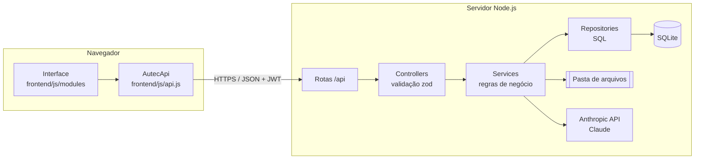
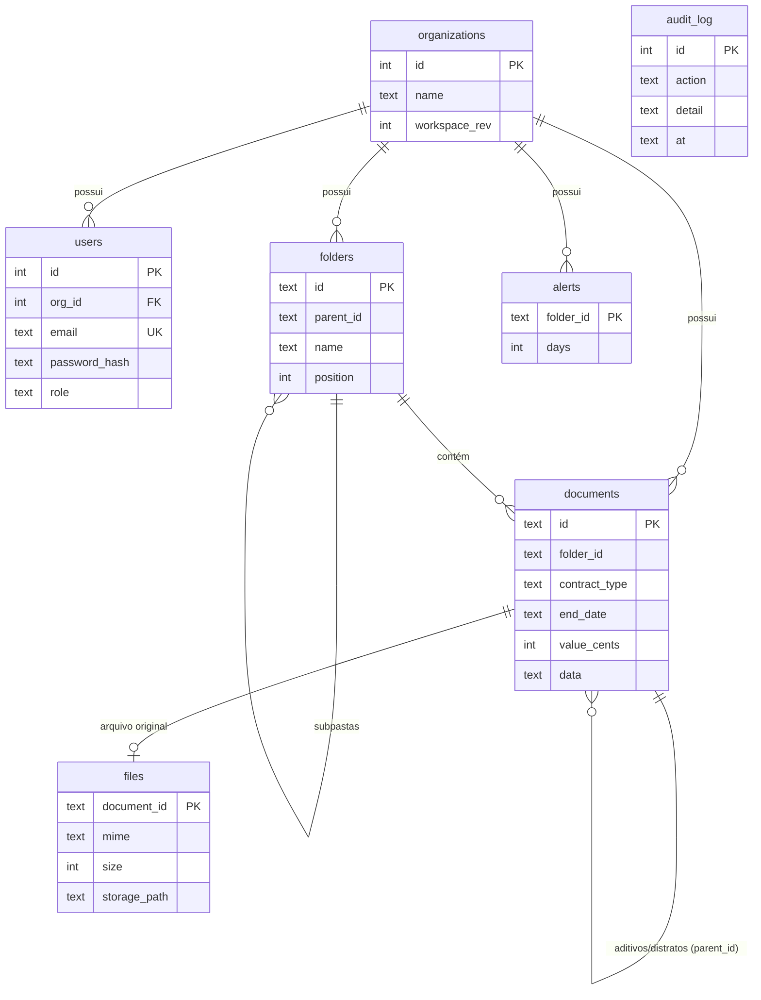

# Arquitetura

## Visão geral

O back-end segue uma **arquitetura em camadas**. Cada camada só conhece a camada de baixo:

| Camada | Responsabilidade | Exemplos |
|---|---|---|
| **Routes** | Mapear URL → controlador, aplicar autenticação | `routes/index.ts` |
| **Controllers** | Ler a requisição, validar com zod, responder | `AuthController`, `WorkspaceController` |
| **Services** | Regras de negócio | `AuthService`, `WorkspaceService`, `AiService` |
| **Repositories** | SQL e conversão linha ↔ objeto | `UserRepository`, `WorkspaceRepository` |
| **Database** | Conexão e migrações | `Database.ts`, `migrations/*.sql` |

As dependências são montadas em `container.ts` (injeção de dependência manual), o que facilita testes e a troca do banco no futuro.

## Modelo de dados

- **Pastas** formam a hierarquia Unidade › Região › Fornecedor.
- **Documentos** guardam o registro completo em `data` (JSON) e repetem em colunas os campos usados em consultas (tipo, datas, valor). Assim nenhum dado extraído pela IA se perde e os relatórios no servidor continuam rápidos.
- **audit_log** registra login, salvamentos, uploads, uso da IA e ações de administração.

## Fluxos principais

### Login
1. `POST /api/auth/login` → `AuthService` compara a senha com o hash bcrypt.
2. O servidor devolve um **JWT** (validade padrão 12h), guardado pelo navegador.
3. Toda requisição seguinte envia `Authorization: Bearer <token>`.

### Salvar alterações (controle de versão otimista)
1. O navegador agrupa alterações por ~0,5 s e envia `PUT /api/workspace` com o número de versão (`rev`) que conhece.
2. Se outra pessoa salvou antes, o servidor responde **409** e o navegador recarrega a versão mais recente, avisando o usuário.
3. Arquivos de documentos excluídos são removidos do disco.

### Upload e leitura por IA
1. O arquivo vai para `PUT /api/documents/:id/file` e é salvo em `STORAGE_DIR`.
2. O navegador monta o pedido (PDF em base64 ou texto do DOCX) e chama `POST /api/ai/messages`.
3. O `AiService` acrescenta a chave da Anthropic e encaminha. A resposta volta em JSON e preenche os campos do contrato.

## Decisões e próximos passos

- **SQLite** foi escolhido para instalação zero. Para muitos usuários simultâneos, reimplemente os repositórios com PostgreSQL (as rotas e serviços não mudam).
- O espaço de trabalho é salvo como um todo, o que é simples e consistente para equipes pequenas. Ver [ROADMAP](ROADMAP.md) para a evolução para rotas por documento.
